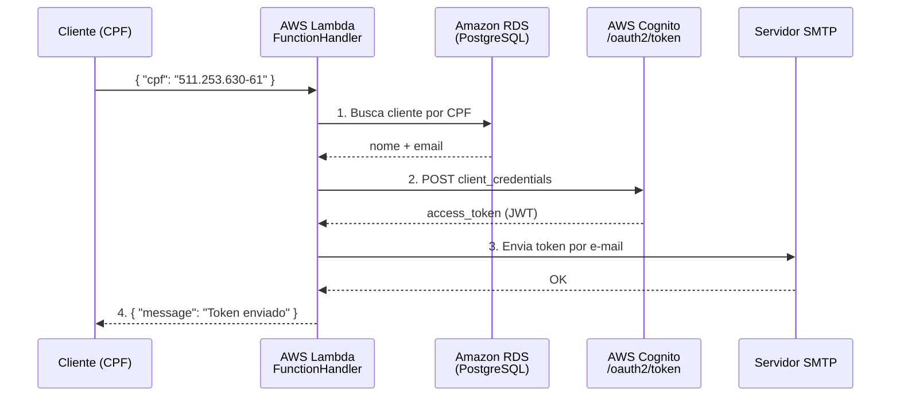
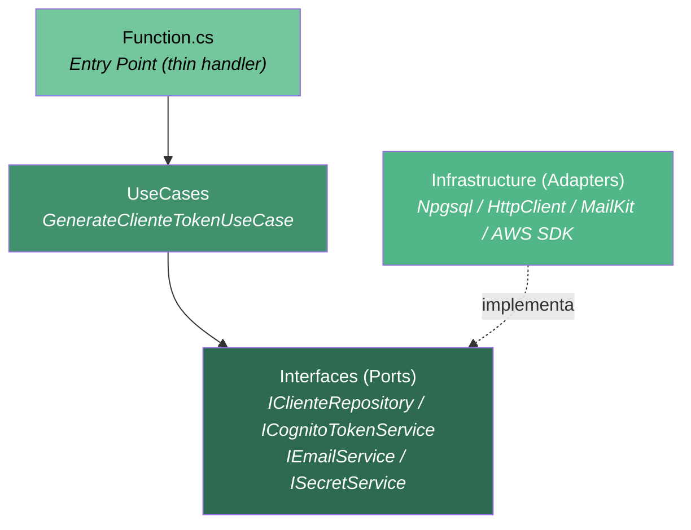

# Mecânica Hermes — CognitoTokenLambda

AWS Lambda function responsável por autenticar clientes cadastrados na **Mecânica Hermes**, gerando um token JWT via **AWS Cognito** e enviando-o por e-mail ao cliente.

## Visão Geral

A função recebe o **CPF** de um cliente, consulta o banco de dados PostgreSQL (Amazon RDS) para validar o cadastro, obtém um token JWT do AWS Cognito e envia o token ao e-mail registrado do cliente via SMTP.



## Arquitetura

O projeto segue **Clean Architecture** adaptada para AWS Lambda — mantendo separação de responsabilidades (Ports & Adapters) dentro de um único projeto para otimizar o tamanho do pacote de deployment e o tempo de cold start.



```text
CognitoTokenLambda/
├─ Function.cs                            # Entry point — handler Lambda (thin)
├─ Startup.cs                             # Composition Root — configuração do container DI
├─ Models/                                # DTOs de entrada/saída
│  ├─ TokenRequest.cs                     # Input: { "cpf": "..." }
│  ├─ TokenResponse.cs                    # Output: { "message": "..." }
│  ├─ ClienteInfo.cs                      # DTO interno: nome + email do cliente
│  └─ CognitoTokenResponse.cs            # DTO interno: resposta do Cognito /oauth2/token
├─ Configuration/                         # Modelos de configuração (Settings)
│  ├─ CognitoSettings.cs                  # Credenciais Cognito (via AWS Secrets Manager)
│  ├─ EmailSettings.cs                    # Configurações SMTP (via variáveis de ambiente)
│  └─ RdsSettings.cs                      # Configurações RDS (via variáveis de ambiente)
├─ Interfaces/                            # Ports — abstrações (contratos de saída)
│  ├─ IClienteRepository.cs               # Consulta de cliente por CPF
│  ├─ ICognitoTokenService.cs             # Obtenção de token JWT
│  ├─ IEmailService.cs                    # Envio de e-mail com token
│  └─ ISecretService.cs                   # Acesso ao AWS Secrets Manager
├─ UseCases/                              # Lógica de negócio (orquestração)
│  └─ GenerateClienteTokenUseCase.cs      # Caso de uso principal
└─ Infrastructure/                        # Adapters — implementações concretas
   ├─ Persistence/
   │  └─ ClienteRepository.cs             # Npgsql + RDS IAM Authentication
   ├─ Cognito/
   │  └─ CognitoTokenService.cs           # HttpClient POST /oauth2/token
   ├─ Email/
   │  └─ EmailService.cs                  # MailKit/SMTP
   └─ Secrets/
      └─ SecretService.cs                 # AWS Secrets Manager SDK
```

## Detalhamento das Camadas

### Function (Entry Point)

**Responsabilidade**: Ponto de entrada da Lambda. Recebe o `TokenRequest`, valida o CPF e delega ao caso de uso.

**Características:**

- **Handler thin**: `FunctionHandler` não contém lógica de negócio — apenas validação de entrada, delegação ao `GenerateClienteTokenUseCase` e tratamento de exceções.
- **DI no construtor**: O `ServiceProvider` é criado uma única vez durante o cold start e reutilizado em invocações subsequentes (warm start).
- **Construtor interno para testes**: Aceita um `ServiceProvider` pré-configurado para facilitar testes unitários.
- **Mascaramento de CPF**: Logs exibem apenas os 4 últimos dígitos (`***3061`) para segurança.

### Models (DTOs)

**Responsabilidade**: Modelos de dados para serialização/deserialização.

- **`TokenRequest`** — entrada da Lambda (`public`, serializado pelo Lambda Runtime).
- **`TokenResponse`** — saída da Lambda (`public`, contém apenas `Message`).
- **`ClienteInfo`** — `record` imutável com nome e e-mail do cliente (`public`, usado pelo caso de uso).
- **`CognitoTokenResponse`** — `internal`, mapeia a resposta JSON do Cognito (`access_token`, `expires_in`, `token_type`).

### Configuration (Settings)

**Responsabilidade**: Modelos de configuração carregados de variáveis de ambiente e AWS Secrets Manager.

- **`RdsSettings`** — Host, Port, Database e Username do RDS. Lido de variáveis de ambiente via `FromEnvironment()`.
- **`EmailSettings`** — Configurações SMTP completas. Lido de variáveis de ambiente via `FromEnvironment()`.
- **`CognitoSettings`** — Credenciais do Cognito (`client_id`, `client_secret`, `domain`, `scope`). Carregado do AWS Secrets Manager e cacheado em memória.

### Interfaces (Ports)

**Responsabilidade**: Contratos de saída (Ports) — definem o que a camada de negócio precisa, sem saber como é implementado.

| Interface | Método | Descrição |
| --- | --- | --- |
| `IClienteRepository` | `GetByIdentificacaoFiscalAsync(cpf)` | Busca cliente por CPF no banco |
| `ICognitoTokenService` | `GetTokenAsync()` | Obtém JWT do Cognito |
| `IEmailService` | `SendTokenEmailAsync(email, nome, token)` | Envia token por e-mail |
| `ISecretService` | `GetCognitoSettingsAsync()` | Lê credenciais do Secrets Manager |

### UseCases (Lógica de Negócio)

**Responsabilidade**: Orquestra o fluxo principal da Lambda.

O `GenerateClienteTokenUseCase` executa três passos:

1. **Consulta o cliente** no banco via `IClienteRepository`. Se não encontrado, retorna mensagem de erro.
2. **Solicita o token** ao Cognito via `ICognitoTokenService`.
3. **Envia o token** por e-mail via `IEmailService`.

**Características:**

- Sem dependências de infraestrutura — depende apenas das interfaces (Ports).
- Retorna `TokenResponse` com mensagem padronizada de sucesso ou falha.

### Infrastructure (Adapters)

**Responsabilidade**: Implementações concretas das interfaces definidas nos Ports.

#### Persistence — `ClienteRepository`

- **Npgsql direto** (sem EF Core) — reduz o tamanho do pacote e o cold start.
- **RDS IAM Database Authentication** — gera token temporário via `RDSAuthTokenGenerator` usando as credenciais da IAM Role da Lambda. Sem senha de banco em variáveis de ambiente.
- **SSL obrigatório** (`SslMode.Require`) — exigido pelo RDS IAM Auth.
- **Source-generated Regex** (`[GeneratedRegex]`) para normalização do CPF — compilado em build time para melhor performance.

#### Cognito — `CognitoTokenService`

- **`HttpClient` estático** — reutilizado entre invocações (Lambda best practice).
- **`client_credentials` grant** — POST para `{domain}/oauth2/token` com `FormUrlEncodedContent`.
- **Tratamento de erro detalhado** — inclui status code e body da resposta do Cognito na exceção.

#### Email — `EmailService`

- **MailKit/SMTP** — mesma biblioteca utilizada no `mecanica-hermes-api`.
- **Flag `Enabled`** — permite desabilitar envio de e-mail em ambientes de teste.
- **Template HTML** — e-mail formatado com nome do cliente e token em bloco de código.

#### Secrets — `SecretService`

- **AWS SDK** — `AmazonSecretsManagerClient` sem região hardcoded (usa `AWS_REGION` da Lambda automaticamente).
- **Cache em memória** — credenciais do Cognito são lidas uma única vez e reutilizadas.
- **SecretId configurável** — via variável de ambiente `COGNITO_SECRET_ID` (fallback: `CognitoTokenLambda`).

## Princípios Arquiteturais Aplicados

### Clean Architecture (adaptada para Lambda)

A dependência entre camadas segue a Dependency Rule (ver [diagrama acima](#arquitetura)):

- **Interfaces** não possuem dependências de infraestrutura.
- **UseCases** dependem apenas de Interfaces.
- **Infrastructure** implementa as Interfaces.
- **Function** orquestra via DI e delega ao UseCase.

### Ports & Adapters (Hexagonal)

- **Ports**: `IClienteRepository`, `ICognitoTokenService`, `IEmailService`, `ISecretService` — definidos na camada de Interfaces.
- **Adapters**: `ClienteRepository`, `CognitoTokenService`, `EmailService`, `SecretService` — implementados na camada de Infrastructure.

### Dependency Injection

- **`Microsoft.Extensions.DependencyInjection`** como container.
- **Singleton** para serviços stateless e configurações (reutilizados entre invocações quentes).
- **Transient** para o `GenerateClienteTokenUseCase` (nova instância por invocação).
- **Composição no construtor da Function** — executada uma única vez no cold start.

### AWS Lambda Best Practices

| Prática | Implementação |
| --- | --- |
| **Minimizar cold start** | Npgsql direto (sem EF Core), 512MB de memória |
| **Reutilizar conexões** | `HttpClient` estático, `AmazonSecretsManagerClient` estático |
| **Cache de secrets** | `SecretService` cacheia `CognitoSettings` em memória |
| **DI no construtor** | `ServiceProvider` criado uma vez, reutilizado em warm starts |
| **Segurança** | Senha RDS via Secrets Manager, credenciais Cognito via Secrets Manager, CPF mascarado em logs |
| **Timeout adequado** | 30s para acomodar cold start + cadeia de chamadas |
| **Pacote enxuto** | Projeto único, sem dependências desnecessárias |

## Configuração

### Variáveis de Ambiente

| Variável | Obrigatória | Descrição |
| --- | --- | --- |
| `RDS__Host` | Sim | Endpoint da instância RDS (auto-descoberto via GitHub Actions) |
| `RDS__Port` | Sim | Porta do RDS (auto-descoberto via GitHub Actions) |
| `RDS__Database` | Sim | Nome do banco de dados |
| `RDS__Username` | Sim | Usuário do banco de dados (padrão: `postgres`) |
| `COGNITO_SECRET_ID` | Sim | Nome do secret no Secrets Manager (fixo: `mechermes-{env}-cognito-client-secret`) |
| `EmailSender__Enabled` | Não | Habilita/desabilita envio de e-mail (padrão: `false`) |
| `EmailSender__SmtpServer` | Sim* | Hostname do servidor SMTP |
| `EmailSender__SmtpPort` | Não | Porta SMTP (padrão: `25`) |
| `EmailSender__SslRequired` | Não | SSL obrigatório (padrão: `false`) |
| `EmailSender__UserName` | Não | Usuário para autenticação SMTP |
| `EmailSender__Password` | Não | Senha para autenticação SMTP |
| `EmailSender__SenderInformation__Name` | Sim* | Nome do remetente |
| `EmailSender__SenderInformation__Address` | Sim* | E-mail do remetente |

\* Obrigatórias quando `EmailSender__Enabled` = `true`.

**Nota:** Quando o deploy é realizado via GitHub Actions:

- `RDS__Host` e `RDS__Port` são **automaticamente descobertos** da infraestrutura AWS
- `COGNITO_SECRET_ID` é **fixo** (`mechermes-{env}-cognito-client-secret`)
- A **senha do banco de dados** não é uma variável de ambiente - ela está no secret do Cognito

#### Exemplo de Comando AWS CLI

```bash
aws lambda update-function-configuration \
  --function-name CognitoTokenLambda \
  --environment "Variables={
      RDS__Host=my-rds-endpoint.rds.amazonaws.com,
      RDS__Port=5432,
      RDS__Database=mechermesdb,
      RDS__Username=postgres,
      RDS__Password=my-db-password,
      COGNITO_SECRET_ID=mechermes-prd-cognito-client-secret,
      EmailSender__Enabled=true,
      EmailSender__SmtpServer=smtp.example.com,
      EmailSender__SmtpPort=587,
      EmailSender__SslRequired=true,
      EmailSender__UserName=mailer,
      EmailSender__Password=SuperSecret123,
      EmailSender__SenderInformation__Name='Mecânica Hermes',
      EmailSender__SenderInformation__Address=no-reply@mecanica.com
  }"
```

### AWS Secrets Manager

#### Cognito Secret (Auto-criado pelo GitHub Actions)

O secret do Cognito é **automaticamente criado/atualizado** pelo GitHub Actions durante o deploy. Você **não precisa criar ou configurar nada manualmente**.

**Nome do Secret:**

- **HML:** `mechermes-hml-cognito-client-secret`
- **PRD:** `mechermes-prd-cognito-client-secret`

**Estrutura do Secret (criada automaticamente):**

```json
{
  "client_id": "auto-discovered-from-cognito-user-pool",
  "client_secret": "auto-discovered-from-cognito-app-client",
  "domain": "auto-discovered-from-cognito-user-pool",
  "scope": "mechermes/client",
  "db_password": "auto-discovered-from-rds-master-secret"
}
```

**O workflow GitHub Actions descobre automaticamente:**

1. **User Pool ID** - via `aws cognito-idp list-user-pools` (nome: `mechermes-{env}-userpool`)
2. **Client ID** - via `aws cognito-idp list-user-pool-clients` (nome: `mechermes-{env}-client`)
3. **Client Secret** - via `aws cognito-idp describe-user-pool-client`
4. **Domain** - via `aws cognito-idp describe-user-pool`
5. **DB Password** - do RDS Master Secret no AWS Secrets Manager
6. Cria/atualiza o secret combinado no AWS Secrets Manager

### Permissões IAM (Execution Role)

A Lambda execution role precisa das seguintes permissões:

```json
{
  "Version": "2012-10-17",
  "Statement": [
    {
      "Effect": "Allow",
      "Action": "secretsmanager:GetSecretValue",
      "Resource": "arn:aws:secretsmanager:<region>:<account-id>:secret:mechermes-*-cognito-client-secret-*"
    }
  ]
}
```

**Nota:** A Lambda utiliza autenticação por senha (não IAM Database Authentication). A senha do banco de dados é injetada automaticamente via GitHub Actions a partir do AWS Secrets Manager.

## Request / Response

**Request:**

```json
{
  "cpf": "511.253.630-61"
}
```

**Sucesso (200):**

```json
{
  "message": "O token foi gerado e enviado para seu e-mail cadastrado."
}
```

**Falha — cliente não encontrado:**

```json
{
  "message": "Não foi possível gerar o seu token. Erro: Cliente não encontrado para o CPF informado."
}
```

**Falha — erro interno:**

```json
{
  "message": "Não foi possível gerar o seu token. Erro: {exception.Message}"
}
```

## Stack Tecnológica

| Tecnologia | Versão | Uso |
| --- | --- | --- |
| .NET | 10.0 | Runtime |
| Amazon.Lambda.Core | 2.8.1 | Lambda SDK |
| AWSSDK.RDS | 4.0.18 | RDS IAM Auth Token Generator |
| AWSSDK.SecretsManager | 4.0.4.8 | Acesso ao Secrets Manager |
| Npgsql | 10.0.1 | Driver PostgreSQL |
| MailKit | 4.15.1 | Cliente SMTP |
| Microsoft.Extensions.DependencyInjection | 10.0.4 | Container DI |

## Deploy

### GitHub Actions (Recomendado)

O projeto possui um workflow automatizado em `.github/workflows/deploy.yml` que realiza o deploy via GitHub Actions.

#### Variáveis de Repositório Necessárias

Configure as seguintes variáveis em **Settings → Secrets and variables → Actions → Variables**:

| Variável | Descrição | Exemplo |
|----------|-----------|---------|
| `AWS_DEFAULT_REGION` | Região AWS | `us-east-1` |
| `LAMBDA_EXECUTION_ROLE_ARN` | ARN da IAM Role para execução da Lambda | `arn:aws:iam::${aws_account_id}:role/LabRole` |

#### Secrets de Repositório Necessários

Configure os seguintes secrets em **Settings → Secrets and variables → Actions → Secrets**:

| Secret | Descrição |
|--------|-----------|
| `AWS_ACCESS_KEY_ID` | AWS Access Key ID |
| `AWS_SECRET_ACCESS_KEY` | AWS Secret Access Key |
| `AWS_SESSION_TOKEN` | AWS Session Token (se usando credenciais temporárias) |
| `EMAIL_USERNAME` | Usuário SMTP |
| `EMAIL_PASSWORD` | Senha SMTP |

#### Execução do Workflow

1. Acesse **Actions** no repositório GitHub
2. Selecione **Deploy - Lambda Function**
3. Clique em **Run workflow**
4. Escolha o ambiente (`hml` ou `prd`)
5. Clique em **Run workflow**

O workflow irá:

- Descobrir automaticamente a infraestrutura AWS (RDS, VPC)
- **Criar/atualizar o secret do Cognito** no AWS Secrets Manager (incluindo senha do DB)
- Compilar e empacotar a função Lambda
- Criar ou atualizar a função no AWS Lambda
- Configurar variáveis de ambiente
- Configurar VPC para acesso ao RDS

### Deploy Manual (Local)

Instalar o Amazon.Lambda.Tools se ainda não instalado:

```bash
dotnet tool install -g Amazon.Lambda.Tools
```

Publicar a função:

```bash
cd CognitoTokenLambda
dotnet lambda deploy-function mechermes-{env}-cognito-token-lambda \
  --function-role arn:aws:iam::<aws_account_id>:role/LabRole \
  --disable-interactive true
```

### Configuração de Deploy (`aws-lambda-tools-defaults.json`)

| Parâmetro | Valor | Justificativa |
| --- | --- | --- |
| `function-runtime` | `dotnet10` | .NET 10 managed runtime |
| `function-memory-size` | `512` | Melhor cold start para .NET (mais memória = mais CPU) |
| `function-timeout` | `30` | Acomoda cold start + DB + Cognito + Email |
| `function-architecture` | `x86_64` | Compatibilidade padrão |
