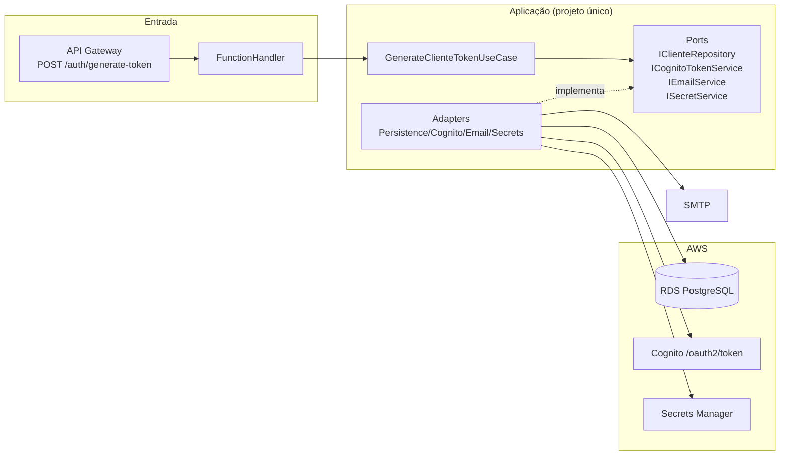

# Arquitetura da Lambda de Token Cognito

Este documento descreve a arquitetura da função `CognitoTokenLambda`.

## Escopo do repositório

O repositório contém uma função AWS Lambda responsável por:

1. Receber CPF.
2. Consultar cliente no PostgreSQL (RDS).
3. Solicitar token JWT ao Cognito (client_credentials).
4. Enviar token por e-mail ao cliente.

## Visão arquitetural

## Organização em camadas

- **Entry Point**: `Function.cs`
- **Composition Root**: `Startup.cs`
- **Use case**: `UseCases/GenerateClienteTokenUseCase.cs`
- **Ports**: `Interfaces/`
- **Adapters**: `Infrastructure/`
- **Configurações**: `Configuration/`
- **Modelos**: `Models/`

## Decisões operacionais relevantes

- Projeto único para reduzir complexidade de deployment.
- DI inicializada no cold start para reutilização em warm starts.
- `HttpClient` e `AmazonSecretsManagerClient` reutilizados.
- Senha do banco obtida de secret consolidado (`client_id`, `client_secret`, `domain`, `scope`, `db_password`).
- CPF normalizado para somente dígitos antes da consulta.
